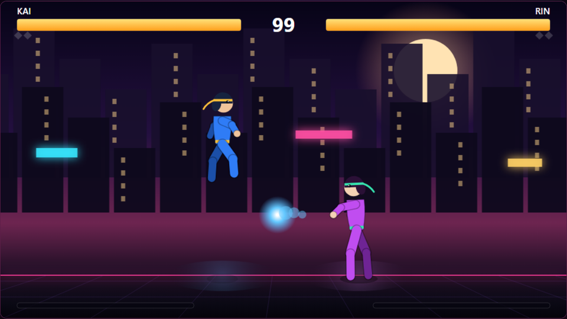

<p align="center">
  
</p>

<p align="center">
  
  
  
  
</p>

```console
koma@workstation:~$ whoami
王浩 · AI 机器视觉 — 工业表面检测 / 零依赖开发者工具

koma@workstation:~$ cat focus.txt
› 能在真实光照下活下来的视觉算法，不是只会跑 demo 的
› 指标可以复现、可以追溯、可以被人挑刺
› 交付物要能直接交给产线或答辩现场

koma@workstation:~$ ls projects/
ivi-detect/   neon-rumble/   camera-lens-calculator/   tcp-coordinator/
```

---

### ▍01 // IVI-DETECT · 工业表面缺陷智能检测平台

> 纯本地离线运行（Python + OpenCV），不依赖 GPU 与网络，双击即用。
> 双频通道 + 代价最优判定：把"能检出"变成"敢下线"。

| 指标 | 基线 Otsu | **IVI-Detect** | 变化 |
| :--- | ---: | ---: | ---: |
| 精确率 | 24.1% | **98.2%** | +74.1 pt |
| 召回率 | 38.2% | **90.7%** | +52.5 pt |
| F1 | 0.295 | **0.943** | ×3.2 |
| 良品误报率 | 100% | **0%** | 归零 |
| 单帧耗时 | 8.4 ms | 35.6 ms | CPU 可接受 |

评测口径：160 张 640×480 图像 / 310 处缺陷 / IoU≥0.30 匹配，全部脚本可复现。

<p align="center">
  <a href="https://github.com/ha035414-cmyk/ivi-detect"></a>
  
  
</p>

---

### ▍02 // NEON RUMBLE · 浏览器里的 2D 格斗

<p align="center">
  <a href="https://hao035414-cmyk.github.io/neon-rumble/">
    
  </a>
</p>

| | |
| :--- | :--- |
| **零依赖** | Canvas 2D + ES modules，无引擎、无构建步骤 |
| **真格斗逻辑** | 起手 / 判定 / 收招帧、硬直、击倒、连段递减 |
| **能打** | CPU 会防空会发波，同一键盘本地双人 |
| **有测试** | 模拟层不依赖 DOM，7 组测试在 CI 每次推送运行 |

<p align="center">
  <a href="https://hao035414-cmyk.github.io/neon-rumble/"><b>▶ 立即试玩</b></a>
  &nbsp;·&nbsp;
  <a href="https://github.com/ha035414-cmyk/neon-rumble">源码</a>
  &nbsp;·&nbsp;
  <a href="https://github.com/ha035414-cmyk/neon-rumble/actions/workflows/test.yml"></a>
</p>

---

### ▍03 // TOOLING

| 项目 | 是什么 |
| :--- | :--- |
| **[camera-lens-calculator](https://github.com/ha035414-cmyk/camera-lens-calculator)** | 工业相机与镜头选型计算器，纯前端零依赖，现场选型不再靠 Excel |
| **[tcp-coordinator](https://github.com/ha035414-cmyk/tcp-coordinator)** | Windows TCP 协调中枢：发现、消息、租约锁、共享板；桌面端 + CLI，零依赖 |

---

### ▍SYS.MONITOR

<p align="center">
  
</p>

<p align="center">
  
  
  
  
  
  
  
  
</p>

<p align="center">
  <a href="https://github.com/ha035414-cmyk"></a>
  <a href="mailto:hao035414@gmail.com"></a>
</p>

<details>
<summary><b>EN · Read in English</b></summary>

<br>

**koma** — Wang Hao. AI machine vision, industrial surface inspection, small sharp developer tools.

- **IVI-Detect** — offline industrial surface defect detection (Python + OpenCV, CPU only). Dual-frequency channels plus cost-weighted decision: F1 **0.295 → 0.943** on a 160-image / 310-defect set, zero false positives on good parts.
- **NEON RUMBLE** — a dependency-free 2D fighting game in the browser. Canvas + ES modules, real frame data, CPU opponent, local 2P, CI-tested simulation layer.
- **camera-lens-calculator** — industrial camera / lens selection calculator, pure front-end.
- **tcp-coordinator** — Windows TCP coordination hub (discovery, messaging, lease locks); desktop app + CLI.

Everything here runs offline and can be verified by running the scripts in the repo.

</details>

<p align="center"><sub>BUILD 2026.11 · LOCAL-FIRST · NO CLOUD REQUIRED</sub></p>
