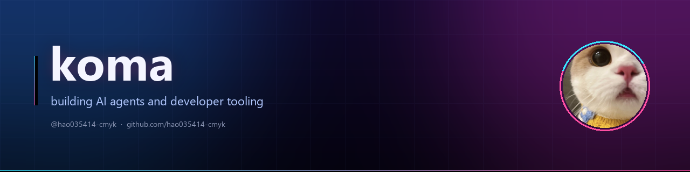
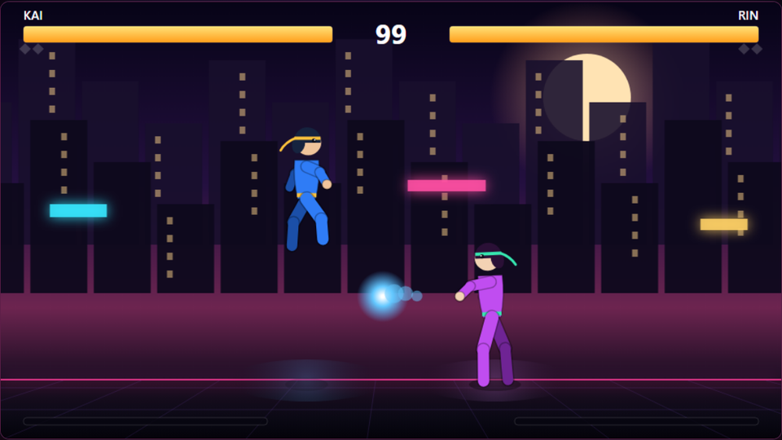

  

<h3 align="center">Featured work</h3>

  

**NEON RUMBLE** — a dependency-free 2D fighting game that runs in the browser.

| | |
| --- | --- |
| **Zero dependencies** | Canvas 2D + ES modules; no engine, no build step |
| **Real fighting-game logic** | Startup / active / recovery frames, hitstun, blockstun, knockdowns, combo scaling |
| **Playable** | CPU opponent with anti-airs and fireballs, plus local 2P on one keyboard |
| **Verified** | The DOM-free simulation runs 7 test groups in CI on every push |

  <a href="https://hao035414-cmyk.github.io/neon-rumble/"><b>▶ Play in browser</b></a>
  &nbsp;·&nbsp;
  <a href="https://github.com/hao035414-cmyk/neon-rumble">Source</a>
  &nbsp;·&nbsp;
  
  

---

### Focus

- **Agents that finish real tasks** — planning, tool use, long-running work
- **The seam between models and tools** — MCP, structured tool calls
- **Reproducible agent workflows** — debugging and evaluation, not demos

### Toolbox

`JavaScript` · `HTML5 Canvas` · `Node.js` · `GitHub Actions` · `Git`

### Elsewhere

- GitHub — [@hao035414-cmyk](https://github.com/hao035414-cmyk)
- Open to collaboration on agent tooling and small, sharp developer tools.

中文

 

**koma，正在构建 AI Agent 及其周边工具链。**

#### 代表作

| 项目 | 简介 |
| --- | --- |
| **[NEON RUMBLE](https://github.com/hao035414-cmyk/neon-rumble)** | 零依赖的浏览器 2D 格斗游戏：Canvas + ES modules，无引擎、无构建步骤。帧数据驱动的战斗（起手/判定/收招、硬直、击倒、连段递减），CPU 会防空会发波，支持本地双人。模拟层不依赖 DOM，7 组测试在 CI 中运行。[▶ 试玩](https://hao035414-cmyk.github.io/neon-rumble/) |

#### 关注点

- **能真正完成任务的 Agent**：规划、工具调用、长任务
- **模型与工具之间的接口**：MCP、结构化工具调用
- **可复现的 Agent 工作流**：调试与评估，而不只是演示

#### 工具

`JavaScript` · `HTML5 Canvas` · `Node.js` · `GitHub Actions` · `Git`

#### 联系

- GitHub：[hao035414-cmyk](https://github.com/hao035414-cmyk)
- 欢迎就 Agent 工具链、以及小而锋利的开发者工具交流合作。

Last updated October 2026 · built in public
